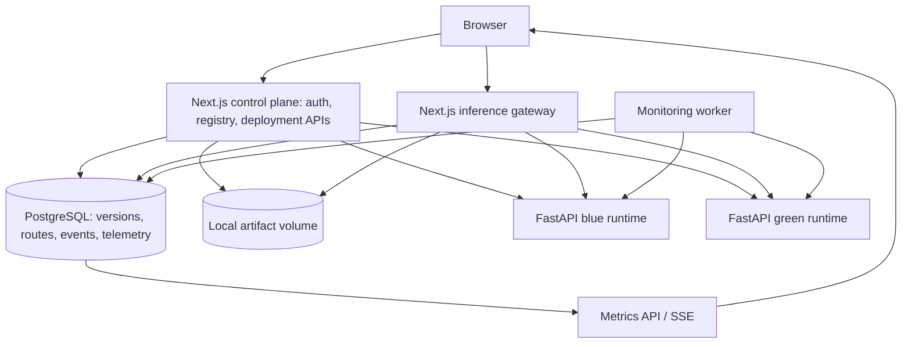
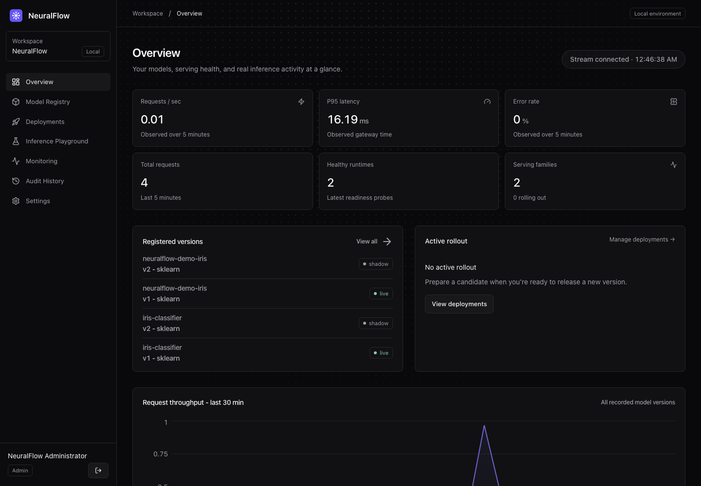
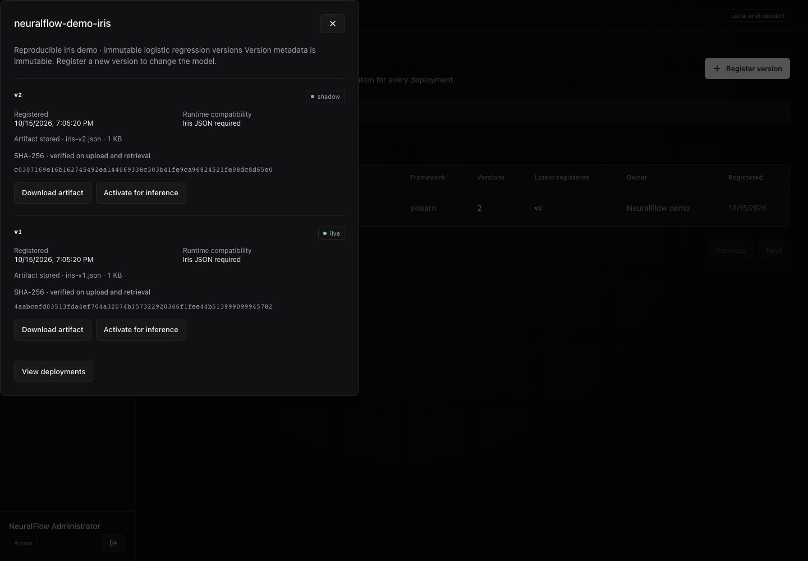
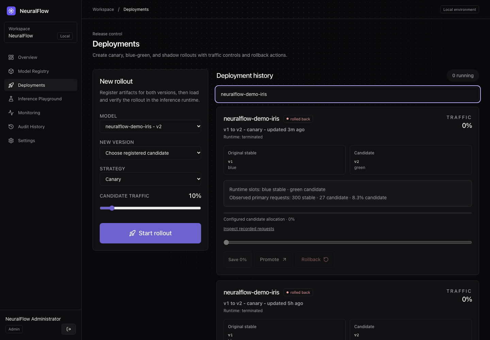
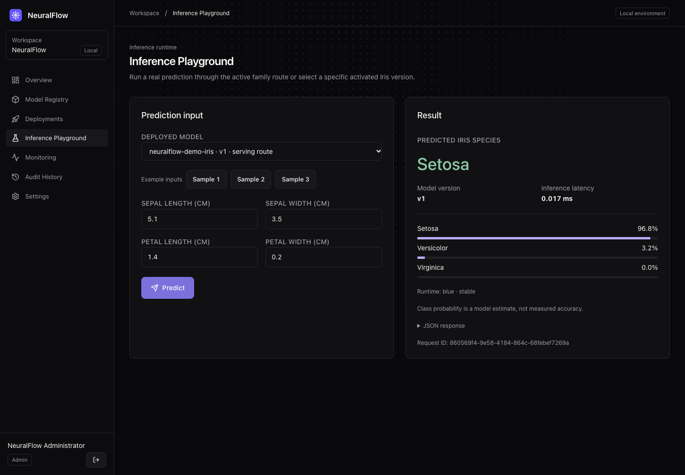
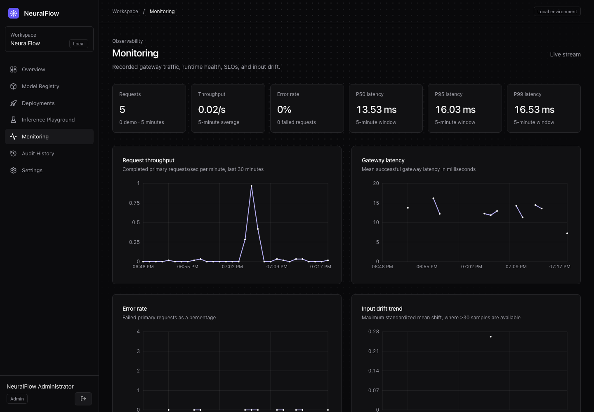

# NeuralFlow

A local MLOps platform for versioning models, serving real predictions, testing controlled rollouts, and observing their results.

## Overview

NeuralFlow follows a model from an immutable registry version to a running inference service. Its dashboard brings registration, release controls, prediction testing, persisted telemetry, and audit history into one workspace. The included Iris example uses two reproducibly trained scikit-learn logistic regression models exported as constrained JSON.

## Why NeuralFlow

Training is one part of delivering ML. A useful model also needs identifiable versions, intact artifacts, reliable inference, measurable releases, and a way back when a release fails. NeuralFlow demonstrates those engineering problems with actual requests and a deliberately small local topology.

## Core features

- PostgreSQL model families and immutable versions with a unique family/version constraint.
- Durable local artifact storage, size/format validation, and SHA-256 verification on retrieval.
- Real Iris inference through a Next.js gateway and private FastAPI runtimes.
- Persistent deployment preparation, readiness verification, events, failure/retry, and idempotent creation.
- Canary allocation, blue-green serving switches, and bounded shadow execution.
- Promotion and rollback that change actual prediction routing.
- Persisted request counts, throughput, error rate, p50/p95/p99, version distribution, runtime health, SLO measurements, and alerts.
- Iris input mean-shift detection with minimum sample sizes. No accuracy claims without labels.
- Better Auth sessions, administrator/operator/viewer access, origin validation, request limits, internal runtime credentials, and audit history.
- Responsive dark dashboard and a real Inference Playground.

## Architecture



Blue and green are independent slots. The serving route determines which is stable or candidate; requests do not pass through one runtime to reach the other. See [architecture](docs/architecture.md).

## Technology stack

Next.js 16, React, TypeScript, Tailwind CSS, Recharts, Better Auth, Prisma 7, PostgreSQL 16, Python 3.11, FastAPI, NumPy, scikit-learn training, Docker Compose, Node test runner, pytest, and Playwright. Dependency versions are locked in `package-lock.json` and Python requirement files.

## Screenshots

Captured from the running local demo with genuine model artifacts, predictions, and persisted telemetry. Counts and time-window metrics reflect the capture time and will change as new traffic arrives.

| Overview | Model registry |
|---|---|
|  |  |

| Deployments | Inference playground |
|---|---|
|  |  |

### Monitoring



## Quick start

Requires Node.js 22, npm, Docker Desktop/Compose, and available loopback ports 3000, 5432, 8001, and 8002. macOS Apple Silicon and Linux images use native multi-architecture base images; this release was exercised on the local Mac environment.

```sh
git clone https://github.com/sniiitik/NeuralFlow.git
cd NeuralFlow
cp .env.example .env
npm ci
npm run env:init
npm run db:generate
docker compose up -d postgres
npm run db:init
npm run auth:bootstrap
docker compose --profile app up -d --build
npm run demo:setup
npm run demo:check
```

Open **http://localhost:3000**. Read `NEURALFLOW_ADMIN_EMAIL` and `NEURALFLOW_ADMIN_PASSWORD` privately from `.env`. `env:init` creates random local credentials and preserves existing configured values; it prints no secrets.

`db:init` is only for an empty database. For an existing installation, use `npx prisma migrate status` and `npm run db:deploy` when an upgrade is needed. Historical ordering prevents ordinary `prisma migrate dev` shadow replay; [the migration guide](docs/migrations.md) explains the compatible process. Never reset a database to follow this quick start.

To start an already configured installation:

```sh
docker compose --profile app up -d
```

For frontend development, stop only the Compose app (`docker compose stop app`), retain PostgreSQL/runtimes/monitor, and run `npm run dev` on port 3000. The browser origin must match `BETTER_AUTH_URL`.

## Demo

```sh
npm run demo:setup
npm run demo:check
npm run demo:traffic -- --count=100
```

Setup registers/verifies only the reserved demo family and artifacts, activates v1 if no route exists, and preserves an existing route. It does not silently undo a rollout. The traffic command authenticates with your configured administrator account and sends one real request per second as ordinary user traffic; it never inserts metrics directly. Local state under `var/demo` contains identifiers, not credentials, and is ignored by Git.

For a useful canary distribution, configure v1 → v2 at 10% candidate traffic in Deployments, then run `npm run demo:traffic -- --count=300` **before recording**. A few requests need not match 90/10 exactly. Follow [the timed demo script](docs/DEMO_SCRIPT.md) for a 4–5 minute walkthrough.

## Testing

```sh
npm ci
npx prisma validate
npm run typecheck
npm run lint
npm run build
docker compose config --quiet
docker compose build app
```

Integration tests require a separate migrated database named with an `_test` suffix and both real runtimes. Export its URL as `TEST_DATABASE_URL`; never use your primary database. See [testing and release verification](docs/release-verification.md) for exact commands, fresh initialization, authenticated gateway tests, restart verification, Python tests, and browser checks.

| Command | Coverage |
|---|---|
| `npm test` | Registry, constraints, lifecycle, routing, telemetry, drift, persistence |
| `npm run test:inference` | Actual artifact loading and predictions |
| `npm run test:security` | HTTP authentication, roles, origin checks, source classification, release flow |
| `npm run test:ui` | Registration, prediction, promotion/rollback, responsive layouts, keyboard behavior |
| `docker build --target test -t neuralflow-inference-test inference` followed by `docker run --rm neuralflow-inference-test` | Python runtime tests |

GitHub Actions configuration is included. Local verification does not mean the workflow has run on GitHub.

## Security

**NeuralFlow is a local technical demonstration and is not intended for public production deployment.** Host ports bind to loopback; runtimes require an internal credential. Public signup is disabled, and write operations require an authorized session and matching origin. Keep `.env`, artifact volumes, dumps, and browser session files out of Git. See [security controls, advisories, backup and recovery](docs/security.md).

## Known limitations

- Fixed two-slot Compose topology; no autoscaling, high availability, or distributed deployment worker.
- Only the constrained Iris JSON format runs inference. Generic JSON/safetensors storage does not imply executable framework support.
- Rate limiting and runtime caches are process-local; HTTPS ingress, MFA, tenant isolation, and managed secret rotation remain future work.
- Shadow execution is bounded and isolated but may consume gateway time; it is not a durable asynchronous queue.
- Drift detects standardized mean changes, not all distribution changes or model accuracy.
- Telemetry has age-based retention; audit history and artifacts require an operator retention policy.
- Historical migration ordering still blocks `migrate dev`; fresh initialization uses `db:init`.
- Remaining npm advisories are documented, not suppressed. Browser verification covers Chromium; Safari/Firefox and a full accessibility audit remain unverified.
- The PostgreSQL driver can emit a concurrent-query deprecation warning during integration traffic.

## Roadmap

Potential future work is limited to hardening: canonical migration history, distributed rate limits and reconciliation, reviewed production networking/secrets, broader browser accessibility coverage, and storage lifecycle policies. These are not current capabilities.

[API reference](docs/api.md) · [Architecture](docs/architecture.md) · [Demo script](docs/DEMO_SCRIPT.md) · [Portfolio material](docs/portfolio.md) · [UI system](docs/ui-design.md)
