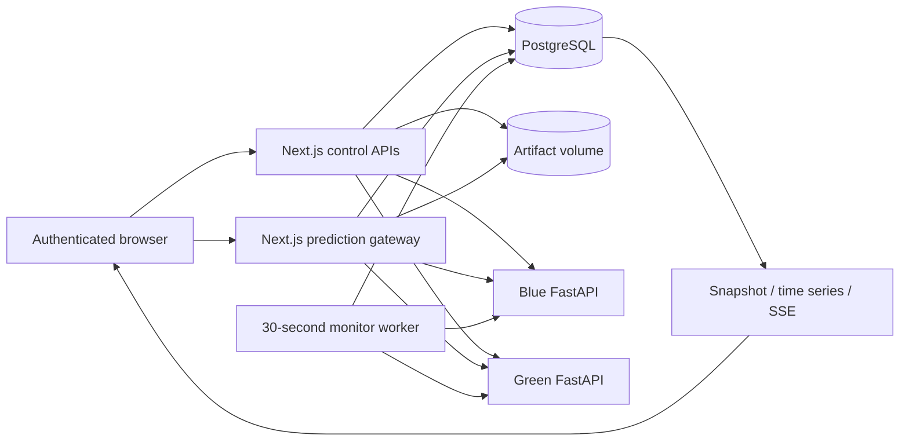
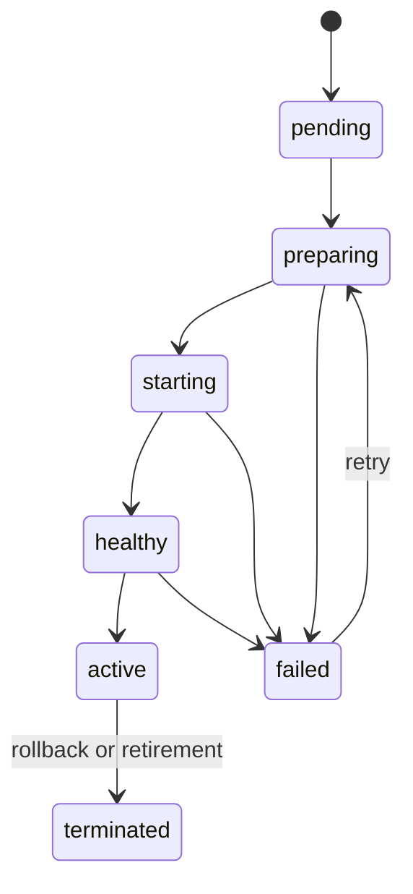

# NeuralFlow architecture

## System overview

NeuralFlow is a local control plane and inference gateway backed by PostgreSQL, with two independently addressed FastAPI runtimes. PostgreSQL is authoritative for model identity, versions, deployment state, serving routes, sessions, events, and telemetry. Runtime caches are disposable. The browser never talks directly to PostgreSQL or receives the runtime credential.

## Control plane and registry

Next.js route handlers in `src/app/api` validate requests with Zod and call registry/deployment modules. `ModelFamily` identifies a model; `ModelVersion` identifies immutable metadata. Family/version uniqueness and a database trigger protect immutable version fields. Archive operations preserve history. Legacy `Model`/`Deployment` tables remain for migration compatibility; new operations use the registry domain.

`ModelArtifact` records the format, storage key, size, and SHA-256. `artifact-storage.ts` validates bounded JSON or safetensors without executable deserialization. Files live under `ARTIFACT_STORAGE_DIR`, mounted into the app from `var/artifacts`. Retrieval rechecks bytes. An artifact may be attached once to a version without one. Database and artifact volume must be backed up together; filesystem writes and SQL commits are not one distributed transaction, so failed operations may leave orphan files requiring reviewed cleanup.

## Deployment lifecycle

`deployments.ts` prepares a registered artifact, loads the designated runtime, verifies readiness, persists lifecycle transitions, and updates the family serving route. States include pending, preparing, starting, healthy, active, failed, and terminated. A deployment status describes the rollout outcome separately. Deployment events and audit entries preserve transitions. Idempotency keys and transactional concurrency checks reject conflicting operations. Recovery reconciles persisted unfinished work when application logic runs; there is no independent durable deployment job scheduler.

`ServingRoute` keeps active, candidate, and previous version/deployment/slot references. Promotion verifies the candidate and changes the persisted route atomically. Rollback restores the retained stable reference. Versions are never rewritten by a release.

## Inference plane and gateway

The supported runtime format is `schemaVersion: 1` with `model.type: "sklearn_iris_logistic_regression"`: declarative coefficients, scaler values, class names, and feature order. The trainer uses scikit-learn; the runtime computes scaling, logits, and softmax using Python arithmetic and the standard-library `math` module. No pickle, arbitrary Python, uploaded shell commands, or Docker API is exposed. Each process can cache multiple version/checksum identities independently. Restarting a runtime clears its cache; subsequent requests can validate and reload the registered artifact.

The gateway resolves a family route or an explicitly activated deployment, validates four positive Iris measurements (at most 20 cm), calls the selected runtime with an internal credential, and returns prediction, probabilities, actual model version, request ID, and measured inference duration. Routed responses also identify the serving slot/role. Runtime latency and total gateway latency have different meanings and are recorded separately.

## Routing strategies and failures

- **Canary:** weighted selection follows the persisted candidate percentage. Observed counts come from actual executions. Candidate failures can fall back to the stable runtime; failed candidate attempts remain inspectable and are not double-counted as primary failures when fallback succeeds.
- **Blue-green:** stable and candidate occupy separate slots. Candidate serving allocation remains zero until promotion switches the route. The previous version remains available for rollback.
- **Shadow:** eligible requests execute on the stable model and may also execute on the candidate under bounded concurrency/timeouts. Only the stable response is returned. Candidate outcomes are recorded separately, including failures/skips. Mirroring is bounded work in the gateway rather than a durable queue; slow shadow work can add bounded wall-clock cost.

A healthy process is not proof that a particular model is loaded; deployment readiness verifies its version/checksum. A failed stable runtime produces an error when no valid serving path exists. Clients receive structured error codes without internal stack traces. Database and telemetry failures can prevent normal operations; this local architecture makes no high-availability claim.

## Observability pipeline

`InferenceRequest` persists request IDs, versions, slot/role, source, prediction/probabilities, latency, status/error, and validated features. The snapshot aggregates a rolling five-minute window; time series group into minute buckets. PostgreSQL `percentile_cont` calculates p50/p95/p99 of successful primary requests. Shadow and failed candidate attempts remain separate from terminal primary throughput/SLO counts. Requests rejected before resolving a model are outside these inference SLOs.

The worker and metrics API probe runtime readiness and persist health samples. The worker evaluates thresholds every 30 seconds; alerts are deduplicated per kind/window. SSE updates every two seconds, with frontend polling fallback. Request/health rows expire after 30 days and alerts after 90 days; pruning runs at most hourly. Versions, artifacts, reference statistics, deployments, and audit records are retained.

Iris drift is the maximum absolute observed/reference mean difference divided by the training scaler scale. It requires 30 successful primary feature samples per version. Current scores use one hour; chart buckets require 30 samples in that minute. This is mean-shift detection, not prediction accuracy or a general distribution test.

## Authentication and networking

Better Auth stores identities and sessions in PostgreSQL. The proxy enforces administrator/operator/viewer roles, matching Origin on mutations, and process-local rate limits. Previously provisioned legacy demo-role accounts remain prediction-only. Public signup is disabled. If a legacy demo session is used, its telemetry label is derived from the verified session; caller source headers cannot grant permissions or set trusted classifications. Local administrator bootstrap is an operational script and must not be exposed as a public API.

Compose binds app, database, and runtime host ports to `127.0.0.1`. The app participates in control and serving networks; PostgreSQL uses the control network; runtimes use the serving network. Separate host bridge networks allow loopback development access. Control/serving networks are internal. `/healthz` is public status only; readiness, load, and predict require the runtime token. This is not a substitute for production ingress/network policy.

## Persistence and limitations

See `prisma/schema.prisma` for `ModelFamily`, `ModelVersion`, `ModelArtifact`, `RegistryDeployment`, `ServingRoute`, `DeploymentEvent`, `AuditLog`, `InferenceRequest`, `FeatureReference`, `RuntimeHealthSample`, `AlertEvent`, and Better Auth tables. The historical migration names sort incorrectly; [migrations.md](migrations.md) describes safe empty initialization and additive changes.

The system has no scheduler-driven autoscaling, distributed lock service, durable shadow queue, multi-tenant isolation, managed artifact object store, or production secret rotation. A future orchestrator could implement the existing load/readiness contract with versioned services while retaining registry and routing semantics. These are future possibilities, not implemented integrations.
