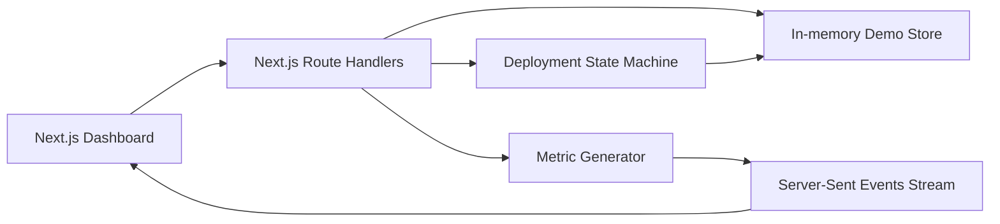
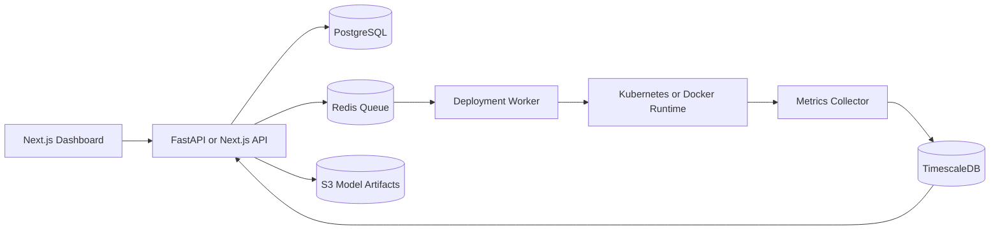

# NeuralFlow Architecture

## Current demo architecture

The project is intentionally simple for a portfolio demo:

- The frontend uses client components for live dashboard interactions.
- The backend uses Next.js Route Handlers under `src/app/api`.
- The store is in memory through `globalThis`, so state persists during the local dev session.
- Live metrics are streamed using Server-Sent Events from `/api/metrics/stream`.

## Production architecture idea

For a production-grade version, evolve it into:

